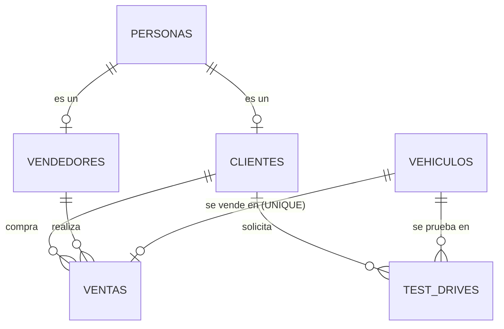

# Modelo de datos

El esquema lo genera DataNucleus al arrancar (`datanucleus.schema.autoCreateAll`). [`db/esquema-referencia.sql`](../db/esquema-referencia.sql) es solo una referencia legible; los nombres exactos de columnas deben contrastarse con `SHOW CREATE TABLE` tras el primer arranque.

## Fase 2 (implementado)

```mermaid
erDiagram
    VEHICULOS ||--o| AUTOS : "es un"
    VEHICULOS ||--o| MOTOS : "es una"
    VEHICULOS ||--o| CAMIONES : "es un"
    VEHICULOS {
        bigint ID PK
        varchar CLASE "discriminador"
        varchar MARCA
        varchar MODELO
        varchar VERSION_MODELO
        int ANIO
        int KILOMETRAJE
        decimal PRECIO "14,2"
        varchar COLOR
        varchar COMBUSTIBLE
        varchar TRANSMISION
        varchar DESCRIPCION
        varchar ESTADO "DISPONIBLE, VENDIDO, EN_TEST_DRIVE"
        varchar FOTO "nombre de archivo"
        bit ACTIVO "baja logica"
        bigint VERSION_FILA "control optimista"
    }
    AUTOS { bigint ID PK_FK
            int PUERTAS }
    MOTOS { bigint ID PK_FK
            varchar TIPO_MOTO
            int CILINDRADA }
    CAMIONES { bigint ID PK_FK
               decimal CAPACIDAD_CARGA_TN }
```

## Fase 3 (implementado)



Restricciones implementadas (ver `db/esquema-referencia.sql`): `PERSONAS.DNI` único; `VENTAS.VEHICULO_ID` único (un vehículo no se vende dos veces); `VENTAS.CLAVE_OPERACION` único (idempotencia); `VENDEDORES.LEGAJO` único; `TEST_DRIVES.VEHICULO_ABIERTO_ID` único y nulo al finalizar (una prueba abierta por vehículo); precio de venta y fecha grabados al vender; no se borran filas referenciadas (baja lógica).
